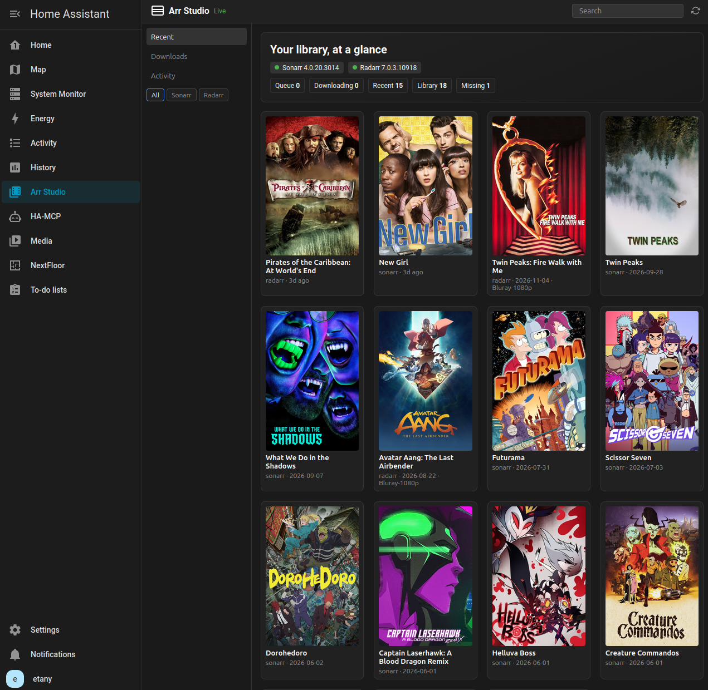
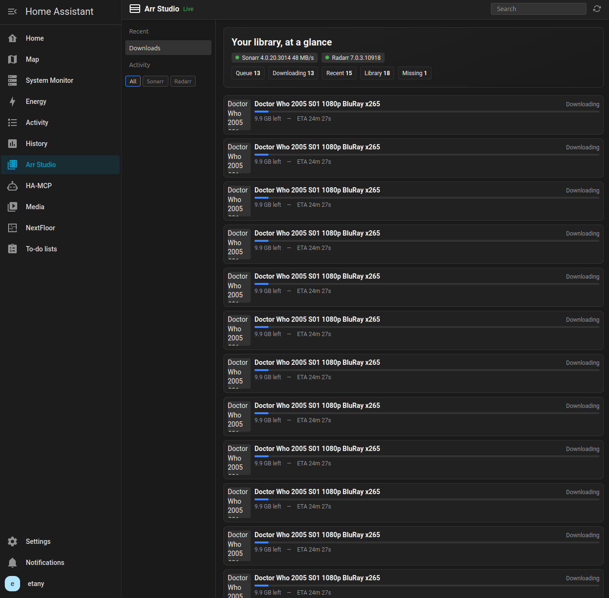
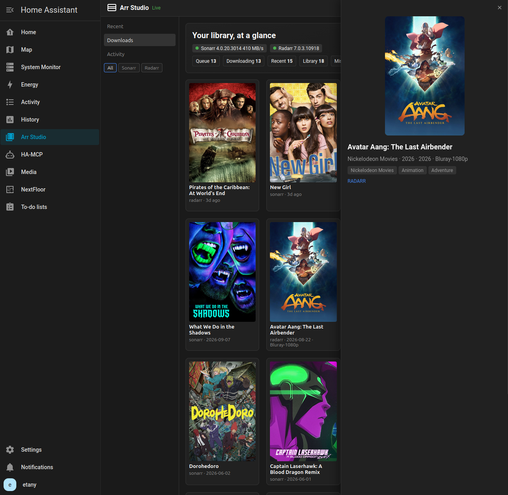
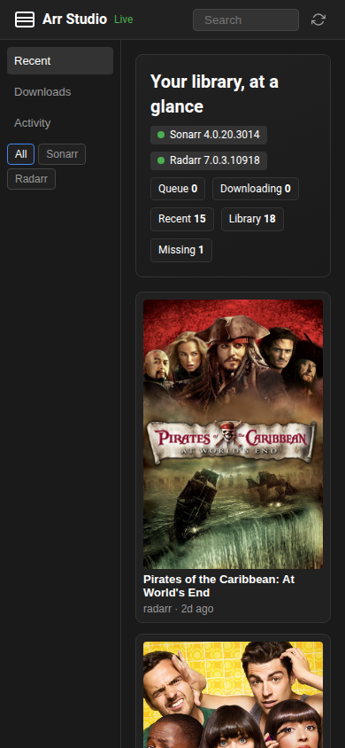

# Arr Studio

**Sonarr & Radarr, beautifully integrated into Home Assistant.**

Arr Studio brings your Sonarr and Radarr libraries into Home Assistant with a cinematic
sidebar panel and native entities you can automate on.

## Features

- **Recently added media** — movies and series with real poster artwork, newest first
- **Live download activity** — progress, speed, ETA, protocol, download client, errors
- **Library at a glance** — title counts, missing items, disk space, server health
- **Thumbnails everywhere** — poster art proxied securely through Home Assistant
- **One integration, many servers** — add Sonarr, Radarr, or both
- **Native entities** — sensors, connectivity, poster image and a refresh button
- **No cloud, no dependencies** — talks directly to your local Arr servers

## Screenshots

| Overview | Downloads |
| --- | --- |
|  |  |

| Detail drawer | Mobile (390×844) |
| --- | --- |
|  |  |

## Installation

### Home Assistant 2026.11 or newer (built-in Marketplace)

1. Go to **Settings → Marketplace**.
2. Open the menu in the top-right corner and choose **Add from link**.
3. Enter `github.com/etanyxyz/Arr-Studio`.
4. Install **Arr Studio**, then restart Home Assistant.

Connecting a GitHub account in the Marketplace is required the first time you add a
custom repository.

### HACS (Home Assistant 2026.10 and older)

1. Open **HACS → Integrations → three-dot menu → Custom repositories**.
2. Add `https://github.com/etanyxyz/Arr-Studio` as type **Integration**.
3. Install **Arr Studio** and restart Home Assistant.

### Manual

Copy `custom_components/arr_studio/` into your Home Assistant `config/custom_components/`
directory and restart Home Assistant.

## Configuration

1. Go to **Settings → Devices & services → Add integration** and search for **Arr Studio**.
2. Choose **Sonarr** or **Radarr**.
3. Enter the server URL — the root only, for example `http://192.168.1.10:8989`, with no
   trailing slash and no `/api/v3` suffix.
4. Enter the API key from your Arr server: **Settings → General → Security → API Key**.
5. Repeat for the other app if you use both.

`Arr Studio` appears in the sidebar once the first server is configured.

## Entities

Each configured server creates one device with:

| Entity | Description |
| --- | --- |
| `sensor.*_queue` | Items currently in the download queue |
| `sensor.*_downloading` | Items actively downloading (with speed attribute) |
| `sensor.*_recent_additions` | Items added recently (latest title attribute) |
| `sensor.*_library` | Titles in the library |
| `sensor.*_missing` | Monitored titles/episodes still missing |
| `sensor.*_disk_free` | Free space on the main disk (GiB) |
| `sensor.*_health_issues` | Number of Sonarr/Radarr health warnings |
| `binary_sensor.*_online` | Whether the server is reachable |
| `image.*_latest_poster` | Poster of the most recently added item |
| `button.*_refresh` | Force an immediate refresh |

The `arr_studio.refresh` action refreshes all servers (or pass an `entry_id` for one).

## Requirements

- Home Assistant **2025.6** or newer
- Sonarr **v4** (live-tested 4.0.20) or Radarr **v5+** (live-tested 7.0.3), reachable from Home Assistant
- An Arr API key

## Troubleshooting

**The panel is missing from the sidebar.** Configure at least one server first, then restart
Home Assistant. The panel appears as soon as the first server is set up.

**A server chip shows offline or an error.** Check that the URL is the server root only
(`http://192.168.1.10:8989`) with no trailing slash and no `/api/v3` suffix, and that the
server is reachable from Home Assistant. The error chip shows the failing endpoint, e.g.
`Connection to sonarr failed at /health`.

**Authentication failed (401).** A reauth flow opens automatically in the notifications panel.
Re-enter the API key (the URL is kept from the existing configuration) and the entry reloads
without a restart. If you keep the same key, enter it again as-is.

**Data sensors go unavailable while a server is down.** By design: `binary_sensor.*_online` is
the signal, and the data entities recover automatically once the server responds again. Other
servers keep working while one is offline.

**`disk_free` shows `unknown`.** The server did not report usable disk space.

**Posters do not load.** Poster artwork is proxied through the Arr server itself, so the server
must be reachable from Home Assistant.

## Development

The implementation plan, architecture and testing notes live in [`docs/`](docs/):

- [`docs/PLAN.md`](docs/PLAN.md) — the build plan and specification
- [`docs/TESTING.md`](docs/TESTING.md) — local development harness
- [`docs/ARCHITECTURE.md`](docs/ARCHITECTURE.md) — how the pieces fit together

Live credentials for local validation are read from a git-ignored `.env`
(see `.env.example`) by `scripts/live_smoke.py`.

```bash
cp .env.example .env    # then fill in URLs and API keys
python3 scripts/live_smoke.py
python3 scripts/preflight.py --phase 0
pytest -q
```

## Licence

[MIT](LICENSE)

## Disclaimer

Arr Studio is an unofficial community project. It is not affiliated with, endorsed by, or
supported by the Sonarr, Radarr, or Home Assistant projects. Sonarr and Radarr are
trademarks of their respective owners.